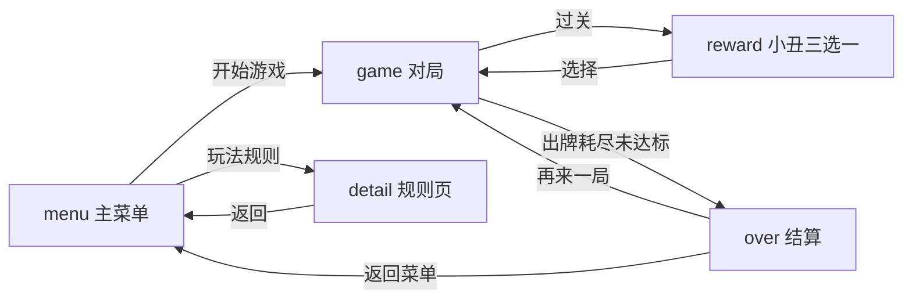

# PRD — 小丑牌·腕上版（Joker Hand）

> Vela 快应用 · 小米手表扑克肉鸽小游戏 | 以《小丑牌 Balatro》玩法为原型
> 屏幕规格：466×466 圆屏（designWidth 480）
> 视觉规范：参照 Vela 手表 UI 设计参考（设计稿规格表，见 docs/DESIGN.md）

## 1. 需求背景

| 项 | 说明 |
|----|------|
| 项目背景 | 为小米手表（VelaOS）提供一款轻量、可单手游玩的扑克牌型构筑小游戏；原型为《小丑牌 Balatro》的核心玩法（扑克牌型计分 × 小丑牌增益 × 逐步升级盲注） |
| 目标用户 | 手表用户，通勤/碎片时间娱乐，单次对局 3–8 分钟 |
| 业务目标 | 完整可玩的单局循环（开局→盲注→构筑→结算），支持最高分持久化，体积 < 2MB |

## 2. 功能模块

| 编号 | 优先级 | 功能 | 说明 |
|------|--------|------|------|
| F001 | P0 | 主菜单 | 游戏标题、开始游戏、玩法规则入口、历史最高分展示 |
| F002 | P0 | 对局-盲注系统 | 每轮一个目标分数（盲注），逐轮递增（300 / 660 / 1450 / 3200 … 公式 round(n)=ceil(300×2.2^(n-1) / 10)×10） |
| F003 | P0 | 对局-手牌操作 | 发 8 张手牌；点击选中/取消（≤5 张）；出牌计分或弃牌重抽；每轮 4 次出牌、3 次弃牌 |
| F004 | P0 | 对局-牌型计分 | 识别 10 种扑克牌型；得分 =（基础筹码 + 所选牌面筹码）× 基础倍率 × 小丑修正；分数动画滚动 + 目标进度条 |
| F005 | P0 | 小丑牌构筑 | 过关后三选一获得小丑牌（8 种效果池，可叠加持有上限 5 张），永久生效到本局结束 |
| F006 | P0 | 结算与最高分 | 出牌次数耗尽且未达标→游戏结束；展示轮数/总分/最高分；最高分写入 storage |
| F007 | P1 | 玩法规则页 | 牌型表、小丑说明、操作方式（复用模板 detail 页改造） |
| F008 | P1 | 反馈系统 | 音效 9 种（选牌/出牌/弃牌/洗牌/计分/奖励/胜利/失败/点击）+ 短振动 |
| F009 | P2 | 防抖与容错 | 按钮防重复点击；音频失败静默降级（仅振动）；storage 失败兜底 |

### 牌型与计分表（F004）

| 牌型 | 条件 | 基础筹码 | 基础倍率 |
|------|------|---------:|---------:|
| 高牌 | 无任何组合 | 5 | 1 |
| 对子 | 一对 | 10 | 2 |
| 两对 | 两对 | 20 | 2 |
| 三条 | 三张同点 | 30 | 3 |
| 顺子 | 5 张点数连续 | 30 | 4 |
| 同花 | 5 张同花色 | 35 | 4 |
| 葫芦 | 三条+对子 | 40 | 4 |
| 四条 | 四张同点 | 60 | 7 |
| 同花顺 | 同花+顺子 | 100 | 8 |
| 皇家同花顺 | 10-J-Q-K-A 同花 | 100 | 8（额外祝贺文案） |

牌面筹码：A=11，2–10=面值，J/Q/K=10。仅计入所选牌。

### 小丑牌池（F005，共 8 种）

| ID | 名称 | 效果 |
|----|------|------|
| J01 | 小丑的诡计 | 牌型为对子及以上时 +4 倍率 |
| J02 | 红心皇后 | 每张红桃牌 +12 筹码 |
| J03 | 黑桃之刃 | 每张黑桃牌 +3 倍率 |
| J04 | 幸运七 | 手牌含 7 时 +7 倍率 |
| J05 | 双倍欢乐 | 牌型为两对时 ×2 倍率 |
| J06 | 方块商人 | 每张方块牌 +15 筹码 |
| J07 | 同花大师 | 牌型为同花时 +30 筹码且 ×2 倍率 |
| J08 | 小丑王 | 每次出牌固定 +50 筹码 |

## 3. 页面结构

| 页面 | 路由 | 说明 |
|------|------|------|
| 游戏主页 | pages/index | 状态机单页：menu / game / reward / over 四视图 |
| 玩法规则 | pages/detail | 牌型表 + 小丑表 + 操作说明（scroll 长内容） |

导航关系：

## 4. 交互逻辑

| 用户操作 | 页面反馈 | 逻辑处理 |
|----------|----------|----------|
| 点击手牌 | 牌面上移高亮（蓝框）/复原 | 切换 selected；已选 5 张时提示"最多选择 5 张" |
| 点击「出牌」 | 得分滚动动画（约 700ms）+ 进度条推进 | 评估牌型→小丑修正→累计分数→消耗 1 次出牌→补牌至 8 张→判定过关/失败 |
| 点击「弃牌」 | 选中牌消失、新牌滑入 | 消耗 1 次弃牌，弃掉选中牌并补抽；弃牌次数为 0 时提示 |
| 过关 | 进入 reward 视图 | 生成 3 张不重复且未拥有的小丑供选择 |
| 点击小丑卡 | 持有小丑栏更新 | 持有后 round+1、target 按公式递增、新一轮开局 |
| 出牌耗尽 | 进入 over 视图 | 总分与最高分比较并写 storage |
| 点击「开始游戏/再来一局」 | 重置全部状态 | 防重复点击标志位（scoring） |

## 5. 异常处理

| 场景 | 描述 | 处理逻辑 | 提示文案 |
|------|------|----------|----------|
| E01 | 音频播放失败 | audio.onerror 静默降级为仅振动 | 无（不打扰） |
| E02 | storage 读取失败/无记录 | 默认 bestScore=0 | 无 |
| E03 | storage 写入失败 | console.error 记录 + toast | "最高分保存失败" |
| E04 | 选牌超过 5 张 | 拒绝选中 | "最多选择 5 张" |
| E05 | 弃牌次数为 0 | 拦截弃牌 | "弃牌次数已用完" |
| E06 | 连续快速点击出牌 | scoring 标志位拦截 | 无 |
| E07 | 牌堆余量不足补牌 | 重新洗一轮牌堆补抽 | 无 |
| E08 | 出牌次数耗尽未达标 | 进入结算 | "出牌次数已用完" |

## 6. 数据埋点

> 当前版本无网络上报，仅本地事件定义（供后续接入）：

| Event ID | Name | Trigger |
|----------|------|---------|
| EVT001 | game_start | 点击开始游戏/再来一局 |
| EVT002 | hand_played | 每次出牌计分完成 |
| EVT003 | round_won | 达到盲注目标 |
| EVT004 | joker_picked | 选定小丑牌 |
| EVT005 | game_over | 出牌耗尽进入结算 |

## 7. VelaOS 依赖说明

| 类型 | 名称 | 用途 | features 声明 |
|------|------|------|---------------|
| API | @system.storage | 最高分持久化 | system.storage |
| API | @system.audio | 9 个音效播放 | system.audio |
| API | @system.vibrator | 出牌/奖励/失败振动 | system.vibrator |
| API | @system.prompt | 超限/异常 toast | system.prompt |
| API | @system.router | 菜单→规则页跳转 | 无需声明 |
| 组件 | div / text / image / input / scroll / progress | 布局、卡牌渲染、按钮、长内容、目标进度条 | — |

无第三方 JS 依赖；资源全部本地化（图片 55 张 PNG + 音频 9 个 MP3）。

## 8. 屏幕适配说明

- 目标屏幕：466×466 圆屏（Xiaomi Watch S3/S4/H1 等），兼容 480×480（S1 Pro/S5）与 432×514（REDMI Watch 5）
- 圆屏安全区：上下 padding 48px，左右 padding 36px（媒体查询 shape: circle 兜底）
- 手牌区：8 张牌横排 + 重叠排布（负 margin），选中牌上移，适配圆屏可视宽度约 408px
- 长内容（规则页）使用 `<scroll scroll-y>` 包裹
- 字号规范：大标题 32-36px / 标题 24-28px / 正文 24px / 辅助 20px

## 9. 视觉规范（源自设计参考规格表）

> 详细提取过程与完整令牌见 docs/DESIGN.md。参考设计稿为 Vela 手表 UI 规范模板
> （官方 UI 指南：https://iot.mi.com/vela/quickapp/zh/guide/start/user-interface.html）。

| 令牌 | 值 | 用途 |
|------|----|------|
| 背景 | `#000000` | 页面底色 |
| 面板/卡片 | `#262626` | 按钮、列表行、小丑槽位容器 |
| 弱底纹 | `rgba(255,255,255,0.06)` | 缩略图/图标槽位 |
| 主强调 | `#0D6EFF` | 主按钮、选中态（牌框/出牌键） |
| 正向 | `#19CE79` | 牌型预览名 |
| 负向 | `#EA5130` | 弃牌按钮文字 |
| 主文字 | `#FFFFFF` | 标题、数字 |
| 次文字 | `#D8D8D8` | 描述、辅助信息 |

组件规格：药丸按钮 rx33（高 60）；列表行 rx36（含 92×92 rx24 缩略图槽）；进度条 rx3（高 6）；图标槽 64×64 rx20。
