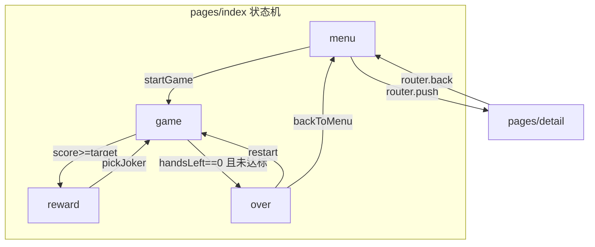
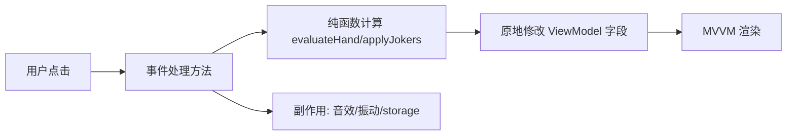

# 技术方案 — 小丑牌·腕上版（Joker Hand）

> 对应 PRD：docs/PRD.md | 项目类型：全新 | 目标平台：Xiaomi VelaOS（watch）

## 1. 概述

- **技术选型**：Vela 快应用原生 .ux 开发范式（MVVM + Flexbox），零第三方依赖，aiot-toolkit 构建
- **核心策略**：单页状态机（view 字段切换 4 个视图）替代多页路由，避免对局中页面切换开销；牌型判定/计分为纯函数，挂模块作用域（非 ViewModel，遵循 Q4/内存优化）
- **资源策略**：全部本地化；卡牌 PNG 112×163（55 张，约 572KB）；音效 MP3 9 个（58KB）

## 2. 页面结构设计

| 页面 | 路径 | 变更类型 | 说明 |
|------|------|----------|------|
| 游戏主页 | src/pages/index/index.ux | ✏️ 重写 | 状态机：menu/game/reward/over |
| 玩法规则 | src/pages/detail/detail.ux | ✏️ 重写 | scroll 长内容 |
| 应用入口 | src/app.ux | ✏️ 修改 | 移除模板 console.log |
| 清单 | src/manifest.json | ✏️ 修改 | features 增补 4 个 API |
| 图标 | src/common/logo.png | ✏️ 替换 | Joker 主题图标 |



## 3. 组件拆分

不拆自定义组件（页面规模小、手表渲染层级敏感），全部使用内置组件：

| 组件 | 白名单 | 用途 |
|------|--------|------|
| div | ✅ | 各视图容器、卡牌、小丑槽位 |
| text | ✅ | 分数、牌型、按钮文字、说明 |
| image | ✅ | 卡面 / 小丑图标 / logo |
| input[type=button] | ✅ | 出牌 / 弃牌 / 开始 / 再来一局等按钮 |
| scroll[scroll-y] | ✅ | 规则页长内容 |

## 4. 数据模型（精确到字段）

### 4.1 Card（模块级数组元素，UI 绑定副本进入 ViewModel）

| 字段 | 类型 | 说明 | 示例 |
|------|------|------|------|
| id | string | 唯一标识 `rank-suit` | `ace-spades` |
| rank | number | 点数 2–14（A=14） | 14 |
| rankLabel | string | 显示点数 | `A` |
| suit | string | 花色 | `spades` |
| img | string | 完整图片路径 | `/common/images/cards/ace_of_spades.png` |
| chips | number | 牌面筹码（A=11,J/Q/K=10） | 11 |
| selected | boolean | 是否选中 | false |
| cls | string | 计算好的样式类名 | `hand-card card-on` |

### 4.2 Joker（小丑牌池条目 / 持有条目）

| 字段 | 类型 | 说明 | 示例 |
|------|------|------|------|
| id | string | 小丑编号 | `J03` |
| name | string | 名称 | `黑桃之刃` |
| desc | string | 效果描述 | `每张黑桃 +3 倍率` |
| icon | string | 图标路径 | `/common/images/cards/black_joker.png` |
| cls | string | 计算好的样式类名（reward 选中态） | `joker-card` |

### 4.3 页面 ViewModel（private）

| 字段 | 类型 | 默认值 | 说明 |
|------|------|--------|------|
| view | string | `menu` | menu/game/reward/over |
| round | number | 1 | 当前盲注轮次 |
| target | number | 300 | 本轮目标分数 |
| roundScore | number | 0 | 本轮累计分 |
| totalScore | number | 0 | 本局总分 |
| handsLeft | number | 4 | 剩余出牌次数 |
| discardsLeft | number | 3 | 剩余弃牌次数 |
| hand | Card[] | [] | 手牌（≤8） |
| jokers | Joker[] | [] | 已持有小丑 |
| rewardChoices | Joker[] | [] | 三选一候选 |
| handName | string | `高牌` | 当前所选牌型预览 |
| handChipText | string | `筹码 0` | 预览筹码 |
| handMultText | string | `倍率 1` | 预览倍率 |
| bestScore | number | 0 | 历史最高分 |
| overRound | number | 0 | 结算展示轮数 |
| scoring | boolean | false | 防抖锁 |

### 4.4 模块作用域（非 UI，export default 外部）

- `deckPool: Card[]` — 牌堆
- `timerIds: number[]` — 待清理定时器
- `HAND_TABLE` / `JOKER_POOL` — 常量表
- 纯函数：`buildDeck()` `shuffle()` `drawCards()` `evaluateHand()` `applyJokers()` `calcTarget()`

## 5. API 调用方案

| API | 调用时机 | 参数 | 返回处理 | 错误处理 |
|-----|----------|------|----------|----------|
| storage.get | onInit 读最高分 | key=`joker_best_score` | JSON.parse→bestScore | fail→默认 0（E02） |
| storage.set | game over 写最高分 | key/value=String(n) | 无 | fail→toast+console.error（E03） |
| audio | 出牌/选牌等 9 场景 | src=/common/audio/*.mp3, play() | onended 不处理 | onerror 静默降级（E01） |
| vibrator.vibrate | 出牌/奖励/失败 | mode=`short`/`long` | 无 | try-catch 包裹 |
| prompt.showToast | 超限/异常提示 | message, duration=1500 | 无 | try-catch 包裹 |
| router.push/back | 菜单→规则页 | uri=`/pages/detail` | 无 | 无需处理 |

## 6. 状态管理与数据流

- 页面内状态全部在 `private`；牌堆等非 UI 数据在模块作用域
- 跨页面状态：无（规则页只读静态内容）
- 数据流向（单向）：



## 7. 文件目录结构

```
joker-cards/
├── package.json               （脚手架）
├── .gitignore                 （脚手架）
├── README.md                  ✏️ 重写
├── THIRD_PARTY_NOTICES.md     🆕 素材署名
├── docs/
│   ├── PRD.md                 🆕
│   └── TECH.md                🆕
├── scripts/                   🆕 素材获取/处理脚本（开发用，不打包）
│   ├── fetch-cards.js
│   └── fetch-audio.js
└── src/
    ├── manifest.json          ✏️ features 增补
    ├── app.ux                 ✏️ 移除 console.log
    ├── config-watch.json      （脚手架，{}）
    ├── pages/
    │   ├── index/index.ux     ✏️ 重写（游戏主体）
    │   └── detail/detail.ux   ✏️ 重写（规则页）
    ├── i18n/                  （脚手架保留）
    └── common/
        ├── logo.png           ✏️ Joker 图标
        ├── images/cards/*.png 🆕 55 张（MIT）
        └── audio/*.mp3        🆕 9 个（CC0）
```

## 8. 技术风险与应对

| 风险 | 影响 | 应对 |
|------|------|------|
| 圆屏边缘裁切 | 手牌/按钮不可点 | 安全区 padding 48/36 + 手牌负 margin 重叠压缩宽度 |
| 音频格式兼容 | 部分机型不播 OGG | 已统一转码 MP3（22kHz/64k 单声道），并有 onerror 降级 |
| 55 张图片内存 | 手表内存有限 | 已压缩至 112×163（平均 10KB）；渲染只挂 8 张手牌 + 小丑图标 |
| 计分动画定时器泄漏 | 内存泄漏 | 全部 timerId 入模块数组，onDestroy 统一清理 |
| 数组整体重赋值（Q5） | 渲染性能 | 卡牌状态原地修改属性（selected/cls） |
| 超长函数（Q7） | 可维护性 | 每个方法 < 50 行，判定/计分拆纯函数 |
